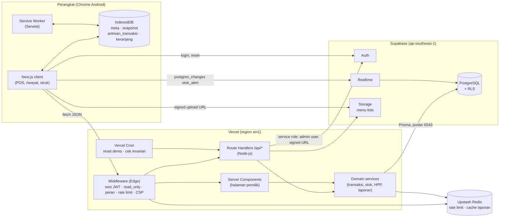

# Architecture — Pusat Dapur

POS & manajemen stok bahan baku untuk UMKM kuliner. Dokumen ini menjelaskan **bagaimana** PRD (`docs/prd-pusat-dapur.md`) dan FRD (`docs/frd pusat dapur/*.md`) dibangun. Aturan bisnis (rumus, batas nilai, kode error, alur per fitur) tetap bersumber dari FRD; dokumen arsitektur merujuknya, tidak mengulang.

> Prioritas jika ada perbedaan: **FRD > dokumen arsitektur > referensi lain**. Jika arsitektur perlu menyimpang dari FRD, FRD diubah lebih dulu.

## Daftar Dokumen

| File | Isi |
|---|---|
| `README.md` | Gambaran umum, stack, keputusan arsitektur (ADR), penelusuran kebutuhan, risiko |
| [`data-model.md`](data-model.md) | Skema database lengkap, constraint, index, ERD, RLS, migrasi |
| [`auth-akses.md`](auth-akses.md) | Supabase Auth, sesi, middleware, matriks akses, isolasi outlet, akun kasir & demo |
| [`alur-domain.md`](alur-domain.md) | Loop inti transaksi, HPP, restock, opname, pembatalan, alert, laporan, konkurensi |
| [`offline-pwa.md`](offline-pwa.md) | PWA, Service Worker, IndexedDB, sync engine, mode simulasi |
| [`api.md`](api.md) | Katalog route halaman & API, konvensi request/response, kode error |
| [`infra-operasional.md`](infra-operasional.md) | Environment, Vercel, Supabase, Upstash, cron, cache, rate limit, keamanan header, observability, backup |
| [`struktur-kode.md`](struktur-kode.md) | Struktur folder repo, layering, konvensi kode, strategi testing, CI/CD |

## Bentuk Arsitektur

**Next.js 15 fullstack monolith** di Vercel dengan **Supabase** (PostgreSQL, Auth, Realtime, Storage) dan **Upstash Redis**. Klien adalah **PWA offline-first** untuk modul kasir.

- **Baca (halaman pemilik):** React Server Components memanggil domain service langsung di server.
- **Baca interaktif & semua mutasi:** Route Handlers `/api/*` (runtime Node.js). **Tidak memakai Server Actions**, karena antrean offline, Background Sync, dan aturan CSRF (`Content-Type: application/json` + cek `Origin`) membutuhkan endpoint REST yang stabil.
- **Akses data:** Prisma, satu-satunya jalur baca/tulis tabel bisnis dari server.
- **Browser → Supabase langsung:** hanya untuk Auth (login/logout/reset), Realtime (`stok_alert`), dan upload foto lewat signed URL. Data API (PostgREST) **dimatikan**.
- **Modul kasir:** app shell di-cache Service Worker; data dari IndexedDB (snapshot + antrean transaksi); dikirim ke server lewat sync engine.

## Stack

| Layer | Pilihan | Catatan |
|---|---|---|
| Runtime & package manager | Node.js 22 LTS + pnpm | Runtime Vercel Functions = Node.js; middleware = Edge |
| Framework | Next.js 15 (App Router), React 19, TypeScript `strict` | |
| Styling & UI | Tailwind CSS v4, shadcn/ui (Radix), Sonner | Touch target ≥ 48px sebagai token desain |
| Auth | Supabase Auth via `@supabase/ssr` | Cookie httpOnly; claim `app_metadata` |
| Database | Supabase PostgreSQL 15+ | 2 project: `dev` dan `prod` |
| ORM | Prisma 6 | Interactive transaction + `$queryRaw` untuk lock & agregat |
| Validasi | Zod 4 | Satu modul skema dipakai client & server |
| Realtime | Supabase Realtime (Postgres Changes) | Hanya tabel `stok_alert` |
| File | Supabase Storage, bucket `menu-foto` | Upload via signed URL |
| Rate limit & cache | Upstash Redis + `@upstash/ratelimit` | Sliding window; cache laporan 60 detik |
| PWA | Serwist (`@serwist/next`) | Precache + runtime caching + Background Sync |
| IndexedDB | `idb` | Wrapper tipis (~1 KB), cocok untuk perangkat low-end |
| Tanggal & zona waktu | `date-fns` + `@date-fns/tz`, locale `id` | Batas hari per `outlets.zona_waktu` |
| Grafik | Recharts, di-*lazy load* hanya di `/dashboard` | Tidak masuk bundle POS |
| Testing | Vitest, Playwright, Supabase CLI (Postgres lokal) | Lihat `struktur-kode.md` |
| Hosting | Vercel Hobby, Supabase Free, Upstash Free | NFR-10 |

### Versi Dikunci

Semua dependensi memakai rentang **dalam satu versi mayor** (`^`), dikunci oleh `pnpm-lock.yaml`. Naik versi mayor hanya lewat PR berlabel `kontrak` yang juga memperbarui dokumen ini. Inisialisasi proyek memakai versi di tabel, **bukan** `@latest`.

| Paket | Versi | Catatan |
|---|---|---|
| Node.js | 22 LTS (`engines.node: ">=22 <23"`, `.nvmrc`) | |
| pnpm | 10 (`packageManager: "pnpm@10.34.9"` di `package.json`) | Corepack & `pnpm/action-setup` butuh versi persis; tetap mayor 10 |
| `next` / `eslint-config-next` | `^15` | Tidak naik ke 16 (API `middleware.ts` dipakai di dokumen) |
| `react`, `react-dom` | `^19` | |
| `typescript` | `^5` | |
| `tailwindcss`, `@tailwindcss/postcss` | `^4` | |
| shadcn/ui | CLI `shadcn@2` (komponen di-copy ke repo) | |
| `prisma`, `@prisma/client` | `^6` | Tidak naik ke 7 (`schema.prisma` memakai `url`/`directUrl`) |
| `zod` | `^4` | |
| `@supabase/supabase-js` | `^2` (versi yang menyediakan `auth.getClaims()`) | |
| `@supabase/ssr` | `^0` (minor terbaru saat #1a, lalu dikunci lockfile) | |
| `@upstash/redis` / `@upstash/ratelimit` | `^1` / `^2` | |
| `@serwist/next`, `serwist` | `^9` | |
| `idb` | `^8` | |
| `date-fns` / `@date-fns/tz` | `^4` / `^1` | |
| `recharts` | `^3` | |
| `lucide-react`, `sonner` | minor terbaru saat #1b, lalu dikunci lockfile | |
| `jose` | `^6` | Hanya bila jalur cadangan `getClaims()` dipakai |
| `vitest`, `@testing-library/react`, `fake-indexeddb` | `^3`, `^16`, `^6` | |
| `@playwright/test`, `@axe-core/playwright` | `^1`, `^4` | |
| Supabase CLI | `^2` (dev dependency `supabase`) | |
| `eslint` / `@eslint/eslintrc` | `^9` / `^3` | ESLint 9 karena peer `eslint-config-next@15`; FlatCompat |
| `eslint-plugin-boundaries` | `^5` | Aturan layering (`struktur-kode.md`) |
| `prettier` | `^3` | |
| `server-only` | minor terbaru saat #1a, lalu dikunci lockfile | |
| `@types/node` / `@types/react`, `@types/react-dom` | `^22` / `^19` | |

## Prinsip Arsitektur

1. **Server adalah sumber kebenaran stok dan uang.** Perangkat hanya memegang salinan (snapshot) dan antrean. Total, HPP, snapshot harga, dan stok selalu dihitung ulang server.
2. **Satu aksi = satu transaksi database.** Setiap operasi yang mengubah stok, harga, atau status transaksi menulis semua efeknya (mutasi, alert, HPP, penandaan `transaksi_gagal`) dalam satu `prisma.$transaction` (NFR-05).
3. **Ledger append-only.** `stok_mutasi` dan `riwayat_harga_beli` tidak pernah di-update/delete; `stok_saat_ini` adalah cache dari Σ mutasi yang diverifikasi harian.
4. **Isolasi berlapis.** `outlet_id` diambil dari sesi → Prisma extension yang memaksa filter outlet → composite FK `(id, outlet_id)` → RLS untuk akses langsung Supabase.
5. **Transaksi tidak pernah dibuang.** Idempotensi `client_tx_id`, antrean IndexedDB, status `gagal` yang dilaporkan ke server.
6. **Ringan di perangkat low-end.** Bundle POS dipisah dari modul pemilik; tidak ada library grafik/form berat di `/kasir`.
7. **Aturan sekali tulis.** Rumus (HPP, margin, konversi, nomor struk, keputusan stok) ada di `src/shared/` dan dipakai client (pratinjau, offline) maupun server (nilai final).

## Keputusan Arsitektur (ADR Ringkas)

| # | Keputusan | Alternatif yang ditolak | Alasan |
|---|---|---|---|
| ADR-01 | Monolith Next.js + Route Handlers REST | Server Actions; backend terpisah | REST dibutuhkan sync offline & Background Sync; satu deploy lebih murah (NFR-10) |
| ADR-02 | Supabase Auth (bukan NextAuth) | NextAuth + tabel sesi | FRD memakai `app_metadata` di JWT untuk RLS & Realtime; satu penyedia identitas |
| ADR-03 | Prisma sebagai satu-satunya akses data server | Supabase JS (PostgREST); Drizzle | Ditetapkan FRD; interactive transaction untuk alur atomik |
| ADR-04 | Logika transaksi di TypeScript (Prisma interactive tx), bukan PL/pgSQL | Fungsi RPC Postgres | Mudah diuji & dipakai ulang (materialisasi demo); latensi sin1↔Singapura cukup untuk p95 ≤ 2 detik |
| ADR-05 | Data API (PostgREST) Supabase dimatikan; RLS tetap aktif sebagai lapis 2 | Mengandalkan RLS saja untuk akses browser | Mencegah kasir membaca field biaya langsung via REST Supabase; RLS tetap menjaga Realtime & akses tak terduga |
| ADR-06 | 2 project Supabase (`dev`, `prod`) dalam satu repo & satu Vercel project | 1 project bersama + preview read-only | Migrasi & uji tidak menyentuh data demo juri |
| ADR-07 | Composite FK `(x_id, outlet_id)` untuk relasi lintas tabel | Validasi aplikasi saja | Database menjamin relasi selalu satu outlet |
| ADR-08 | Advisory lock per outlet untuk hitung ulang HPP | Lock baris `menus` | Mencegah HPP basi saat dua restock paralel menyentuh menu yang sama (lihat `alur-domain.md`) |
| ADR-09 | Kuantitas di client disimpan sebagai integer *milli-unit* (×1000); API mengirim `numeric` sebagai string desimal | `number` float | Menghindari error floating point pada cek stok offline |
| ADR-10 | Cache laporan di Upstash dengan *version key* per outlet | `revalidateTag` Next.js | Invalidasi lintas instance & bisa dipanggil dari domain service |
| ADR-11 | Serwist + `idb` | next-pwa (tidak dirawat), Dexie | Serwist aktif dirawat untuk App Router; `idb` paling kecil |
| ADR-12 | Revokasi token via kolom `users.sesi_valid_sejak` | Menunggu access token kedaluwarsa (1 jam) | Reset kata sandi/nonaktif berlaku segera di semua Route Handler |

## Penelusuran Kebutuhan → Komponen

| Kebutuhan | Komponen utama | Dokumen |
|---|---|---|
| F1 POS, US-05 | `/kasir`, `POST /api/transaksi`, `domain/transaksi/buat-transaksi.ts` | `alur-domain.md`, `offline-pwa.md` |
| F2 auto-deduct, BR-05/07 | `buatTransaksi()` langkah lock → mutasi → alert | `alur-domain.md` |
| F3 resep & template | `domain/resep/*`, `shared/templates/resep.ts` | `alur-domain.md` |
| F4 restock & pratinjau | `domain/stok/restock.ts`, `domain/hpp/hitung-ulang.ts` | `alur-domain.md` |
| F5 HPP & margin, BR-01/02 | `shared/rumus/hpp.ts`, `menus.hpp_cached` | `alur-domain.md`, `data-model.md` |
| F6 alert realtime | `stok_alert` + Supabase Realtime + RLS | `alur-domain.md`, `auth-akses.md` |
| F7 laporan | `domain/laporan/*`, cache Upstash | `alur-domain.md`, `infra-operasional.md` |
| F8 offline sync, BR-06/08 | IndexedDB, sync engine, Serwist | `offline-pwa.md` |
| F9 opname, BR-09 | `domain/stok/opname.ts` | `alur-domain.md` |
| BR-10 ledger | `stok_mutasi`, cron cek invarian | `data-model.md`, `infra-operasional.md` |
| BR-11 isolasi | Prisma extension, composite FK, RLS | `auth-akses.md`, `data-model.md` |
| BR-12 / US-15 peran & demo | Middleware Edge + guard Node, mode simulasi | `auth-akses.md`, `offline-pwa.md` |
| NFR performa | Region sin1, bundle split, index, cache | `infra-operasional.md`, `struktur-kode.md` |

## Spesifikasi Tambahan di Luar FRD

Hal berikut tidak disebut eksplisit di PRD/FRD dan ditetapkan di dokumen arsitektur berdasarkan pertimbangan PRD/FRD. Tinjau sebelum implementasi:

| # | Spesifikasi | Dokumen |
|---|---|---|
| S-01 | Kolom `outlets.is_demo` sebagai penanda outlet demo (dipakai materialisasi & reset) | `data-model.md` |
| S-02 | Kolom `users.sesi_valid_sejak` untuk mencabut access token yang masih berlaku | `auth-akses.md` |
| S-03 | Composite FK `(id, outlet_id)` di semua relasi antar tabel bisnis | `data-model.md` |
| S-04 | RLS diperketat: `SELECT` hanya untuk `pemilik` di outletnya; tidak ada policy tulis untuk role `authenticated` | `data-model.md` |
| S-05 | Data API PostgREST dimatikan | `auth-akses.md` |
| S-06 | Advisory lock `hpp:<outlet_id>` untuk semua operasi yang mengubah harga/resep | `alur-domain.md` |
| S-07 | Prisma Client extension `forOutlet()` yang memaksa filter `outlet_id` | `struktur-kode.md` |
| S-08 | Store IndexedDB tambahan `profil` (identitas user untuk operasi offline) | `offline-pwa.md` |
| S-09 | Bucket `menu-foto` public-read (tulis hanya via signed URL) agar foto bisa di-cache offline | `infra-operasional.md` |
| S-10 | SMTP kustom untuk email reset kata sandi | `infra-operasional.md` |
| S-11 | Backup tambahan `pg_dump` terjadwal via GitHub Actions | `infra-operasional.md` |
| S-12 | Region tunggal Singapura untuk Vercel Functions, Supabase, Upstash | `infra-operasional.md` |
| S-13 | Reset demo menulis 29 hari data secara bulk (bukan lewat fungsi inti) agar muat batas durasi function | `alur-domain.md` |
| S-14 | Cache laporan berbasis version key | `alur-domain.md` |
| S-15 | Trigger DB `append-only` & `transaksi` immutable (pengecualian reset demo via `SET LOCAL app.reset_demo`) | `data-model.md` |
| S-16 | Endpoint tambahan `POST /api/akun/password-reset-selesai` dan `POST /api/log-client`; halaman `/offline` | `api.md` |
| S-17 | Cek invarian harian juga memverifikasi `hpp_cached` | `alur-domain.md` |
| S-18 | Signup publik Supabase dimatikan; registrasi hanya lewat `POST /api/auth/daftar` | `auth-akses.md` |
| S-19 | Rute `/` sebagai pengarah sesuai sesi & peran (redirect `/onboarding` diputuskan server) | `auth-akses.md`, FRD `auth.md` |
| S-20 | Header `X-Waktu-Server` pada snapshot 200/304 | `alur-domain.md`, FRD `offline-sync.md` |
| S-21 | `user_metadata.nama` untuk mengisi `profil` offline tanpa endpoint tambahan | `auth-akses.md` |
| S-22 | `APP_ORIGINS` (Production, Preview `VERCEL_URL` + `VERCEL_BRANCH_URL`, lokal) | `infra-operasional.md` |
| S-23 | Cache shell kasir saat runtime (`WARM_SHELL`, header `x-pd-shell`), bukan precache | `offline-pwa.md` |
| S-24 | Domain `pusat-dapur.vercel.app`, SMTP Brevo, UptimeRobot, tanpa Log Drain | `infra-operasional.md` |
| S-25 | Fungsi inti `xxxDalamTx` + larangan transaksi bersarang | `struktur-kode.md`, `alur-domain.md` |

## Risiko dan Spike Awal

Setiap risiko punya jalur cadangan yang **sudah final**. Hasil spike hanya memilih jalur (utama/cadangan), tidak membuka keputusan baru. Pemilik tugas = issue di `docs/tasks.md`.

| # | Risiko | Dampak | Diverifikasi di | Jalur utama | Jika gagal → jalur cadangan final |
|---|---|---|---|---|---|
| R1 | Supabase Auth menolak email `<username>@kasir.pusatdapur.invalid` | Login kasir by username gagal | #0 | `kasir.pusatdapur.invalid` | `kasir.example.com` (RFC 2606); ubah konstanta `DOMAIN_EMAIL_KASIR` + FRD `akun-kasir.md` (`auth-akses.md`) |
| R2 | Role koneksi server tidak berhak menghapus `auth.sessions` | Revokasi sesi tidak instan | #0 | `DELETE FROM auth.sessions` | Ban 1 detik lalu unban via Admin API (`auth-akses.md`) |
| R3 | `getClaims()` tidak berjalan di Edge | Middleware tidak bisa memverifikasi sesi | #0 | `getClaims()` | `jose` + JWKS (`auth-akses.md`) |
| R4 | Latensi 8 query transaksi dari `sin1` > 300 ms | p95 ≤ 2 detik terancam | #0 | Prisma interactive tx (ADR-04) | Gabungkan langkah 5–8 `buatTransaksiDalamTx` menjadi satu statement CTE (`WITH ins_tx AS (…), ins_detail AS (…), upd_stok AS (…), ins_mutasi AS (…) …`) via `tx.$queryRaw`; tetap di TypeScript |
| R5 | Reset demo > 20 detik | Reset timeout | #0 (ukur), #24a | Vercel Cron + insert `unnest` | Jadwal pindah ke GitHub Actions `demo-reset.yml` (`alur-domain.md`) |
| R6 | SMTP bawaan Supabase hanya mengirim ke anggota tim | Reset kata sandi pemilik tidak sampai | #1a, #14 | Brevo (`infra-operasional.md`) | — (keputusan final) |
| R7 | Vercel Hobby: cron jalan kapan saja dalam jam yang dijadwalkan | Reset demo bisa bergeser hingga ~00:59 | — | Diterima; materialisasi berbasis jam sekarang | — |
| R8 | Supabase Free di-*pause* setelah 7 hari tanpa aktivitas | Project `dev` tidur | #1a | Prod aktif karena cron harian; dev dibangunkan manual dari dashboard | — |
| R9 | Prisma + Supavisor transaction mode | Error prepared statement | #0 | `?pgbouncer=true&connection_limit=1`; migrasi lewat 5432 | — |
| R10 | Cache shell + deploy baru | Kasir memakai versi lama | #18 | Prompt update SW saat keranjang kosong (`offline-pwa.md`) | — |
| R11 | Kuota IndexedDB penuh | Transaksi offline tidak tersimpan | #18 | `navigator.storage.persist()`; error tulis ditampilkan (FRD) | — |
| R12 | Realtime Postgres Changes bermasalah saat Data API dimatikan | Alert tidak realtime | #16 | Realtime + RLS | Fallback polling 60 detik yang sudah ada di FRD `alert-stok.md` dijadikan mekanisme utama; tidak ada perubahan API |

## Delivery

| Fase | Cakupan arsitektur |
|---|---|
| Fase 0 | Skema lengkap + RLS + composite FK, Supabase Auth & middleware, CRUD bahan/menu/resep/template, `POST /api/transaksi` online, restock + HPP, struk, deploy prod |
| Fase 1 | Serwist + IndexedDB + sync engine, snapshot/ETag, `transaksi_gagal`, Realtime alert, laporan + cache, opname, pembatalan, akun demo + cron, rate limit lengkap, cek invarian |
| Pasca-kompetisi | Multi-outlet (tabel relasi user↔outlet, claim outlet aktif), export, billing kuota |

Fase hanya mengatur urutan pengerjaan. Skema dan batas keamanan dibangun lengkap sejak Fase 0 agar tidak ada migrasi struktural di tengah jalan.
