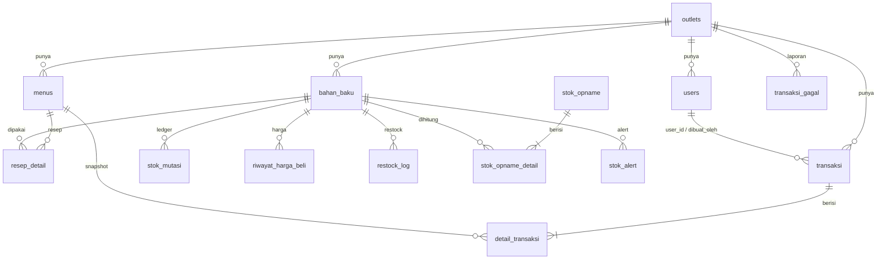

# Data Model

Konvensi tipe mengikuti FRD `non-functional.md` NFR-01; constraint integritas mengikuti NFR-05. Dokumen ini menyatukan semua tabel yang tersebar di FRD dan menambahkan constraint yang dibutuhkan implementasi (ditandai **[S]**).

## Konvensi

| Aspek | Aturan |
|---|---|
| Primary key | `uuid` default `gen_random_uuid()`; kecuali `users.id` = `auth.users.id` |
| Uang | `bigint` (Rupiah utuh) → Prisma `BigInt`; diserialisasi ke JSON sebagai `number` (maks ~4,95×10¹⁰ < 2⁵³) |
| Harga per satuan | `numeric(12,2)` → Prisma `Decimal`; diserialisasi sebagai string `"12.00"` |
| HPP & nilai | `numeric(18,2)`; string di JSON |
| Kuantitas | `numeric(12,3)`; string di JSON (`"200.000"`) |
| Waktu | `timestamptz`, UTC |
| Enum | Postgres enum (Prisma `enum`) |
| Penamaan | `snake_case` di DB; model Prisma memakai `@@map`/`@map` sehingga nama TypeScript = nama kolom (konsisten dengan FRD) |
| Scoping | Semua tabel bisnis punya `outlet_id uuid NOT NULL` |
| Relasi lintas tabel **[S]** | Composite FK `(child.x_id, child.outlet_id) → parent(id, outlet_id)`; parent punya `UNIQUE (id, outlet_id)`. Dimodelkan di `schema.prisma` (lihat Migrasi). Database menjamin relasi selalu satu outlet |

## Enum

| Enum | Nilai |
|---|---|
| `peran` | `pemilik`, `kasir` |
| `zona_waktu` | `Asia/Jakarta`, `Asia/Makassar`, `Asia/Jayapura` |
| `satuan` | `gram`, `ml`, `buah` |
| `satuan_input` | `gram`, `kg`, `ml`, `liter`, `buah` |
| `tipe_pesanan` | `dine_in`, `takeaway` |
| `metode_bayar` | `tunai`, `qris` |
| `status_transaksi` | `selesai`, `dibatalkan` |
| `alasan_batal` | `salah_input`, `pelanggan_batal`, `lainnya` |
| `jenis_mutasi` | `stok_awal`, `penjualan`, `restock`, `opname`, `koreksi_sync`, `pembatalan` |
| `sumber_harga` | `awal`, `restock`, `koreksi` |
| `alasan_opname` | `susut`, `tumpah_rusak`, `salah_catat`, `lainnya` |
| `jenis_alert` | `stok_menipis`, `stok_tidak_sinkron` |

## ERD



## Tabel

Kolom tanpa tanda `?` adalah `NOT NULL`.

### `outlets`

| Kolom | Tipe | Default / aturan |
|---|---|---|
| `id` | uuid PK | |
| `nama_outlet` | text | 1–100 karakter |
| `zona_waktu` | `zona_waktu` | `Asia/Jakarta` |
| `ambang_margin` | smallint | 20; `CHECK (0..100)` |
| `blokir_stok_kurang` | boolean | `true` |
| `onboarding_selesai` | boolean | `false` |
| `is_demo` **[S]** | boolean | `false`; partial unique `WHERE is_demo` (maks satu outlet demo) |
| `created_at`, `updated_at` | timestamptz | `now()` |

### `users`

| Kolom | Tipe | Aturan |
|---|---|---|
| `id` | uuid PK | FK `auth.users(id) ON DELETE RESTRICT` (dibuat di SQL migrasi) |
| `outlet_id` | uuid | FK `outlets` |
| `peran` | `peran` | |
| `read_only` | boolean | `false` |
| `nama` | text | 1–100 |
| `username?` | text | Hanya kasir; `CHECK ((peran = 'kasir') = (username IS NOT NULL))` |
| `aktif` | boolean | `true` |
| `sesi_valid_sejak` **[S]** | timestamptz | `date_trunc('second', now())`; selalu dibulatkan ke detik; JWT dengan `iat` lebih awal ditolak (`auth-akses.md`) |
| `created_at` | timestamptz | `now()` |

- Unique `lower(username) WHERE username IS NOT NULL` → `USERNAME_SUDAH_ADA`.
- **[S]** Partial unique `(outlet_id) WHERE peran = 'pemilik'`: satu pemilik per outlet.
- `UNIQUE (id, outlet_id)` untuk composite FK dari `transaksi`, `stok_mutasi`, dll.

### `bahan_baku`

| Kolom | Tipe | Aturan |
|---|---|---|
| `id`, `outlet_id` | uuid | `UNIQUE (id, outlet_id)` |
| `nama` | text | 1–100 |
| `satuan` | `satuan` | Tidak dapat diubah |
| `stok_saat_ini` | numeric(12,3) | `CHECK (stok_saat_ini >= 0 AND stok_saat_ini <= 999999999.999)` |
| `threshold_min` | numeric(12,3) | `CHECK (>= 0)` |
| `harga_beli_per_satuan` | numeric(12,2) | `CHECK (0..10000000)` |
| `diarsipkan_at?` | timestamptz | |
| `created_at`, `updated_at` | timestamptz | |

- Unique `(outlet_id, lower(nama)) WHERE diarsipkan_at IS NULL` → `NAMA_BAHAN_SUDAH_ADA`.

### `riwayat_harga_beli` (append-only)

`id`, `outlet_id`, `bahan_baku_id`, `harga_lama?` numeric(12,2), `harga_baru` numeric(12,2), `sumber` `sumber_harga`, `ref_id?` uuid, `user_id`, `created_at`.

- `CHECK ((sumber = 'awal') = (harga_lama IS NULL))`, `CHECK ((sumber = 'restock') = (ref_id IS NOT NULL))`.
- Index `(bahan_baku_id, created_at DESC)` (10 entri terakhir di detail bahan).

### `menus`

| Kolom | Tipe | Aturan |
|---|---|---|
| `id`, `outlet_id` | uuid | `UNIQUE (id, outlet_id)` |
| `nama` | text | 1–100; unique `(outlet_id, lower(nama))` → `NAMA_MENU_SUDAH_ADA` |
| `harga_jual` | bigint | `CHECK (1..10000000)` |
| `foto_url?` | text | Diisi server |
| `aktif` | boolean | `true` |
| `hpp_cached` | numeric(18,2) | 0 |
| `created_at`, `updated_at` | timestamptz | |

### `resep_detail`

`id`, `outlet_id`, `menu_id`, `bahan_baku_id`, `takaran` numeric(12,3) `CHECK (takaran > 0 AND takaran <= 100000)`.

- `UNIQUE (menu_id, bahan_baku_id)`; index `idx_resep_menu (menu_id)`, `idx_resep_bahan (bahan_baku_id)`.
- Composite FK ke `menus (id, outlet_id)` dan `bahan_baku (id, outlet_id)`, `ON DELETE CASCADE` hanya untuk `menu_id` (resep diganti penuh oleh `PUT`).

### `transaksi`

| Kolom | Tipe | Aturan |
|---|---|---|
| `id`, `outlet_id` | uuid | `UNIQUE (id, outlet_id)` |
| `client_tx_id` | uuid | `UNIQUE (outlet_id, client_tx_id)` |
| `device_id` | uuid | |
| `nomor_struk` | text | `UNIQUE (outlet_id, nomor_struk)`; `CHECK (nomor_struk ~ '^\d{6}-[0-9A-F]{6}-\d{3,}(-\d+)?$')` |
| `token_struk` | text | `UNIQUE`; 22 karakter base64url |
| `user_id` | uuid | Pengirim request; composite FK `users (id, outlet_id)` |
| `dibuat_oleh` | uuid | Kasir pembuat; composite FK `users (id, outlet_id)` |
| `waktu_transaksi` | timestamptz | |
| `dibuat_offline` | boolean | |
| `tipe_pesanan` | `tipe_pesanan` | |
| `metode_bayar` | `metode_bayar` | |
| `total` | bigint | `CHECK (total > 0)` |
| `uang_diterima?` | bigint | |
| `kembalian?` | bigint | `CHECK ((metode_bayar = 'tunai') = (uang_diterima IS NOT NULL AND kembalian IS NOT NULL))` |
| `koreksi_stok` | boolean | `false` |
| `status` | `status_transaksi` | `selesai` |
| `dibatalkan_at?`, `dibatalkan_oleh?`, `alasan_batal?`, `catatan_batal?` | | `CHECK ((status = 'dibatalkan') = (dibatalkan_at IS NOT NULL))` |
| `created_at` | timestamptz | Waktu diterima server |

- Index `idx_transaksi_outlet_date (outlet_id, waktu_transaksi DESC)`; **[S]** `(outlet_id, created_at DESC)` untuk batas pembatalan & akses kasir "hari ini".
- Kolom yang tidak boleh berubah setelah insert (semua kecuali kolom pembatalan) dijaga trigger **[S]** `trg_transaksi_immutable` yang menolak `UPDATE` di luar kolom `status`, `dibatalkan_*`, `alasan_batal`, `catatan_batal`.

### `detail_transaksi`

`id`, `outlet_id`, `transaksi_id`, `menu_id`, `nama_menu` text, `harga_jual` bigint, `hpp_snapshot` numeric(18,2), `qty` smallint `CHECK (1..99)`, `subtotal` bigint.

- `CHECK (subtotal = harga_jual * qty)`; `UNIQUE (transaksi_id, menu_id)`; index `idx_detail_transaksi (transaksi_id)`; **[S]** index `(outlet_id, menu_id)` untuk `jumlah_terjual_7_hari` & laporan per menu.
- Trigger **[S]** menolak `UPDATE`/`DELETE` (snapshot tidak berubah, NFR-05), kecuali role yang dipakai reset demo (lihat RLS & Role).

### `stok_mutasi` (append-only ledger)

`id`, `seq` bigserial (Prisma `BigInt @default(autoincrement())`, unik), `outlet_id`, `bahan_baku_id`, `jenis` `jenis_mutasi`, `jumlah` numeric(12,3) `CHECK (jumlah <> 0)`, `ref_id?` uuid, `user_id`, `created_at`.

- `CHECK` tanda per jenis: `penjualan` < 0; `stok_awal`, `restock`, `koreksi_sync`, `pembatalan` > 0; `opname` bebas.
- `CHECK ((jenis = 'stok_awal') = (ref_id IS NULL))`.
- `ref_id` polimorfik (transaksi / restock_log / stok_opname) sehingga tanpa FK; integritas dijaga domain service + uji invarian.
- Index `idx_mutasi_bahan (bahan_baku_id, seq DESC)`; **[S]** `(ref_id) WHERE jenis IN ('penjualan','koreksi_sync')` untuk pembatalan.

### `restock_log`

`id`, `outlet_id`, `bahan_baku_id`, `user_id`, `jumlah_input` numeric(12,3), `satuan_input`, `jumlah` numeric(12,3), `total_harga` bigint `CHECK (0..100000000)`, `harga_beli_per_satuan` numeric(12,2), `harga_beli_sebelumnya` numeric(12,2), `created_at`. Index `(outlet_id, created_at DESC)`.

### `stok_opname` dan `stok_opname_detail`

- `stok_opname`: `id`, `outlet_id`, `user_id`, `catatan?` (≤ 200), `created_at`. Index `(outlet_id, created_at DESC)`.
- `stok_opname_detail`: `id`, `outlet_id`, `stok_opname_id`, `bahan_baku_id`, `stok_sistem`, `stok_fisik`, `selisih` (numeric(12,3)), `alasan?` `alasan_opname`, `nilai_selisih` numeric(18,2), `created_at` **[S]** (salinan `stok_opname.created_at`). `UNIQUE (stok_opname_id, bahan_baku_id)`; `CHECK (selisih = stok_fisik - stok_sistem)`.
- **[S]** Index `(bahan_baku_id, created_at)` untuk cek "bahan sudah diopname setelah transaksi diterima" saat pembatalan, tanpa join ke header.

### `stok_alert`

`id`, `outlet_id`, `bahan_baku_id`, `jenis` `jenis_alert`, `sudah_dibaca` (false), `dibaca_at?`, `ditutup_otomatis` (false), `created_at`.

- Partial unique `(bahan_baku_id, jenis) WHERE sudah_dibaca = false`; insert `ON CONFLICT DO NOTHING`.
- Index `idx_alert_unread (outlet_id, sudah_dibaca) WHERE sudah_dibaca = false`.
- `CHECK (sudah_dibaca = (dibaca_at IS NOT NULL))`.
- Masuk publication `supabase_realtime`; `REPLICA IDENTITY FULL` tidak diperlukan (event `UPDATE` cukup membawa row baru).

### `transaksi_gagal`

`id`, `outlet_id`, `client_tx_id`, `device_id`, `user_id`, `payload` jsonb, `pesan_error` text, `created_at`, `updated_at` **[S]**, `ditangani_at?`, `ditangani_otomatis` (false). `UNIQUE (outlet_id, client_tx_id)`. Payload dibatasi 64 KB oleh validasi Zod.

## Kolom Turunan (Tidak Disimpan)

| Nilai | Dihitung di |
|---|---|
| `status_stok`, `dipakai_di_menu` | Query bahan (`CASE`, subquery count) |
| `margin_persen`, `margin_rendah`, `resep_kosong`, `hpp_belum_lengkap`, `harga_jual_minimum` | `shared/rumus/hpp.ts` saat serialisasi response pemilik |
| `jumlah_terjual_7_hari` | Agregat `detail_transaksi` ⋈ `transaksi` (status `selesai`) |
| `stok_berjalan` | Window function `SUM(jumlah) OVER (PARTITION BY bahan_baku_id ORDER BY seq)` |

## RLS dan Role Database

### Role

| Role | Dipakai oleh | RLS |
|---|---|---|
| `postgres` (koneksi Prisma) | Semua Route Handler, cron, seed | Bypass (Supabase); isolasi dijaga lapis aplikasi + composite FK |
| `authenticated` | Browser: Realtime `stok_alert` | Ya |
| `anon` | Browser tanpa sesi | Ya, tanpa policy (deny) |
| `service_role` | Supabase Admin API (Auth, Storage) dari server | Bypass |

Data API (PostgREST) dimatikan di dashboard Supabase (`auth-akses.md`), sehingga role `authenticated` praktis hanya terpakai oleh Realtime. RLS tetap wajib sebagai lapis 2 jika Data API suatu saat dibuka.

### Policy **[S]**

Semua tabel bisnis: `ENABLE ROW LEVEL SECURITY` (tanpa `FORCE`, karena Prisma terhubung sebagai `postgres`, pemilik tabel, yang harus tetap bisa menulis). Helper SQL:

```sql
create function app.outlet_id() returns uuid language sql stable as
$$ select nullif(auth.jwt() -> 'app_metadata' ->> 'outlet_id', '')::uuid $$;

create function app.is_pemilik() returns boolean language sql stable as
$$ select coalesce(auth.jwt() -> 'app_metadata' ->> 'peran', '') = 'pemilik' $$;
```

| Tabel | `SELECT` (`authenticated`) | `INSERT`/`UPDATE`/`DELETE` |
|---|---|---|
| `stok_alert` | `outlet_id = app.outlet_id() AND app.is_pemilik()` (FRD `alert-stok.md`) | Tidak ada policy |
| Semua tabel bisnis lain | `outlet_id = app.outlet_id() AND app.is_pemilik()` | Tidak ada policy |
| `stok_mutasi`, `riwayat_harga_beli` | Sama | Tidak ada policy (append-only, FRD) |

- Kasir **tidak** punya policy `SELECT` di tabel mana pun: semua data kasir lewat API yang sudah menyaring field biaya.
- `REVOKE ALL ON ALL TABLES IN SCHEMA public FROM anon`; `authenticated` hanya `SELECT`.
- Storage `menu-foto`: policy di `infra-operasional.md`.

### Trigger Proteksi **[S]**

| Trigger | Tabel | Efek |
|---|---|---|
| `trg_append_only` | `stok_mutasi`, `riwayat_harga_beli`, `detail_transaksi` | `RAISE EXCEPTION` pada `UPDATE`/`DELETE`, kecuali `current_setting('app.reset_demo', true) = 'on'` **dan** baris milik outlet `is_demo` |
| `trg_transaksi_immutable` | `transaksi` | Hanya kolom pembatalan boleh berubah, hanya dari `selesai` → `dibatalkan` |
| `trg_updated_at` | Tabel dengan `updated_at` | Set `now()` |

Reset demo menjalankan `SET LOCAL app.reset_demo = 'on'` di dalam transaksinya (`alur-domain.md`).

## Index Wajib (Rekap)

| Index | Sumber |
|---|---|
| `idx_transaksi_outlet_date`, `idx_alert_unread`, `idx_resep_menu`, `idx_mutasi_bahan`, `idx_detail_transaksi`, `idx_resep_bahan` | NFR-02 |
| `transaksi (outlet_id, created_at DESC)` | [S] pembatalan, akses kasir |
| `detail_transaksi (outlet_id, menu_id)` | [S] laporan, urutan POS |
| `stok_mutasi (ref_id) WHERE jenis IN (...)` | [S] pembatalan |
| `riwayat_harga_beli (bahan_baku_id, created_at DESC)` | [S] detail bahan |
| `restock_log (outlet_id, created_at DESC)`, `stok_opname (outlet_id, created_at DESC)` | [S] riwayat |
| `stok_opname_detail (bahan_baku_id, created_at)` | [S] pembatalan |

## Migrasi

| Aspek | Aturan |
|---|---|
| Alat | `prisma migrate`; file di `prisma/migrations/` di-commit |
| Membuat migrasi | **Hanya** terhadap Postgres lokal (`supabase start`): `pnpm db:migrate:local --create-only --name <nama>`, edit SQL, lalu `pnpm db:migrate:local` untuk menerapkan. Skrip (`scripts/prisma-env.mjs`) tidak memakai `prisma migrate dev`, karena Prisma menolak FK lintas schema `users.id → auth.users` (P4002). Penggantinya: buat ulang shadow DB lokal `prisma_shadow`, `prisma migrate diff --from-migrations --to-schema-datamodel` untuk folder migrasi baru, lalu `migrate deploy` + `generate` (tanpa `--create-only`). Tidak pernah diarahkan ke Supabase dev/prod |
| Menerapkan ke remote | `prisma migrate deploy` saja: dev via `pnpm db:deploy:dev`, prod via workflow `migrate-prod.yml` |
| Dimodelkan di `schema.prisma` | Semua tabel, kolom, enum, index biasa, unique biasa, **composite FK** (`@@unique([id, outlet_id])` pada induk + `@relation(fields: [x_id, outlet_id], references: [id, outlet_id])` pada anak), `seq` sebagai `BigInt @default(autoincrement())` (BIGSERIAL; bukan identity) |
| SQL manual (tidak bisa dimodelkan Prisma) | Partial/expression unique index (`lower(nama)`, `WHERE …`), `CHECK`, trigger, fungsi `app.*`, RLS & policy, grant/revoke, publication Realtime, FK `users.id → auth.users(id)`. Ditambahkan manual di file migrasi hasil `--create-only`. Migrasi awal mencabut default privileges `anon`/`authenticated`: setiap tabel baru wajib `GRANT SELECT … TO authenticated`, RLS, dan policy eksplisit (diuji `skema.test.ts`) |
| Daftar objek manual | `prisma/manual-objects.sql.md`: daftar nama semua objek manual (index, constraint, trigger, policy). Diperbarui di PR yang sama |
| Aturan review | Setiap file migrasi baru diperiksa: baris `DROP INDEX`/`DROP CONSTRAINT`/`DROP TRIGGER` untuk objek di daftar manual **wajib dihapus** sebelum commit (Prisma menghasilkannya karena tidak mengenal objek tersebut) |
| Drift (CI) | Tidak memakai `prisma migrate diff` (selalu melaporkan objek manual sebagai selisih). Diganti uji integrasi `skema.test.ts`: setelah `migrate deploy` dari nol, setiap objek di `manual-objects.sql.md` ada (`pg_indexes`, `pg_constraint`, `pg_trigger`, `pg_policies`), dan `prisma validate` lulus |
| Urutan lingkungan | lokal → `dev` (`db:deploy:dev`, sebelum PR dibuka) → merge ke `main` → `prod` (`migrate-prod.yml`) |
| Migrasi berubah setelah diterapkan ke dev | Dilarang mengedit file migrasi yang sudah diterapkan ke dev; perbaikan = migrasi baru. Jika PR migrasi ditolak, Agent A membuat migrasi pembalik |
| Kompatibilitas | Expand–contract: migrasi harus kompatibel dengan kode versi sebelumnya karena deploy Vercel dan migrasi prod tidak terjadi bersamaan secara atomik |
| Uji | Suite integrasi menjalankan semua migrasi ke Postgres lokal (Supabase CLI) dari nol |
