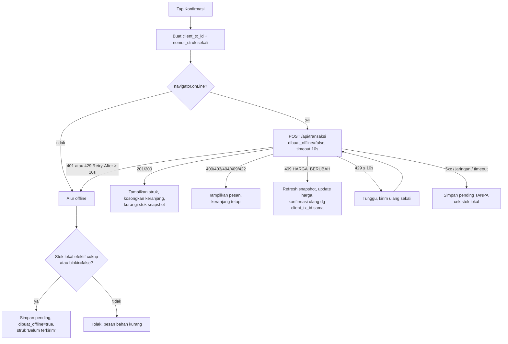

# Offline-First dan PWA

Perilaku fungsional ada di FRD `offline-sync.md`, `pos.md`, `struk.md`, `akun-demo.md` (mode simulasi). Dokumen ini menjelaskan komponen client yang mewujudkannya.

## Komponen Client

```
src/client/offline/
  db.ts            skema IndexedDB (idb), migrasi versi, persist storage
  profil.ts        identitas user untuk operasi offline
  snapshot.ts      ambil/simpan snapshot, ETag, pengurangan lokal pasca-transaksi
  stok-lokal.ts    stok efektif = snapshot − antrean (milli-unit)
  antrean.ts       CRUD antrean_transaksi, status_sync, penghapusan berkala
  sync-engine.ts   putaran sinkronisasi, backoff, lock, laporan gagal
  konfirmasi.ts    alur konfirmasi POS (online → fallback offline)
  nomor-struk.ts   counter per tanggal (memakai shared/nomor-struk.ts)
src/app/sw.ts      Service Worker (Serwist): precache, runtime cache, Background Sync
```

`/kasir`, `/kasir/riwayat`, dan `/struk/[clientTxId]` adalah **client component penuh**. Server hanya merender shell kosong (tanpa data), sehingga shell bisa di-cache dan dibuka tanpa koneksi.

## IndexedDB

Database `pusatdapur`, versi skema dikelola di `db.ts` (`upgrade()` bertahap).

| Store | Key | Index | Isi |
|---|---|---|---|
| `meta` | key string | — | `device_id`, `counter_struk:<YYMMDD>`, `waktu_sinkron_terakhir`, `snapshot_etag` |
| `profil` **[S]** | `'aktif'` | — | `user_id`, `nama`, `peran`, `outlet_id`, `read_only`; diisi setelah login, dihapus saat logout |
| `snapshot` | `'terakhir'` | — | Respons `GET /api/sync/snapshot`; kuantitas dikonversi ke milli-unit (`bigint`→`number` aman: maks 10¹²) |
| `antrean_transaksi` | `client_tx_id` | `status_sync`, `[outlet_id+status_sync]`, `waktu_transaksi` | Field FRD + `payload` |
| `keranjang` | `outlet_id` | — | Keranjang aktif |

- Saat pertama dibuka: `navigator.storage.persist()` diminta agar browser tidak menghapus data di bawah tekanan ruang.
- Kapasitas 500 transaksi: ±2 KB/transaksi → ±1 MB, jauh di bawah kuota.
- Kegagalan tulis (`QuotaExceededError`, dll.) → error ditampilkan, transaksi **tidak** dianggap tercatat (FRD).
- Penulisan transaksi offline memakai satu transaksi IndexedDB (`antrean_transaksi` + `meta` counter + `keranjang`) agar nomor struk, antrean, dan pengosongan keranjang atomik.

## Kuantitas di Client (ADR-09)

Kuantitas dari API (`"200.000"`) dikonversi ke integer milli-unit (`200000`) saat disimpan. Semua perhitungan stok lokal memakai integer, lalu diformat kembali saat ditampilkan. Fungsi `shared/rumus/stok.ts#putuskanStok` menerima milli-unit di client dan `Decimal` di server lewat adaptor tipis, dengan logika keputusan yang sama.

## Snapshot

| Kejadian | Aksi |
|---|---|
| Aplikasi dibuka (online) | `GET /api/sync/snapshot` dengan `If-None-Match` |
| Putaran sync berhasil mengirim ≥ 1 transaksi | Ambil snapshot |
| Interval 5 menit selama online & tab terlihat | Ambil snapshot (`visibilitychange` menjeda interval) |
| Transaksi online 201/200 | Kurangi `stok_saat_ini` snapshot lokal (min 0) |
| 409 `HARGA_BERUBAH` | Ambil snapshot, perbarui harga keranjang |
| Snapshot > 24 jam | Banner peringatan (FRD) |

Snapshot baru menggantikan seluruh store `snapshot` dalam satu transaksi IndexedDB.

## Alur Konfirmasi POS

`konfirmasi.ts` mengimplementasikan FRD `pos.md` "Alur Konfirmasi":



- `client_tx_id` dan `nomor_struk` disimpan di state konfirmasi sampai keranjang dikosongkan, sehingga retry atau konfirmasi ulang tidak pernah membuat ID baru.
- `dibuat_oleh` diambil dari store `profil`.

## Sync Engine

`sync-engine.ts`, satu fungsi `jalankanPutaran()` yang dipakai oleh halaman dan Service Worker.

| Aspek | Implementasi |
|---|---|
| Mutual exclusion | `navigator.locks.request('pusatdapur-sync', { ifAvailable: true }, …)`; fallback flag `meta.sync_lock` berisi timestamp (dianggap basi setelah 60 detik) |
| Pemicu | Background Sync tag `sync-transaksi` (didaftarkan setiap transaksi masuk antrean), event `online`, aplikasi dibuka, setelah login ulang |
| Pemilihan item | `status_sync = pending` dan `outlet_id = profil.outlet_id`, urut `waktu_transaksi` ASC |
| Pengiriman | Serial, satu per satu, timeout 10 detik, header `Content-Type: application/json` (Origin otomatis dari browser/SW) |
| Penanganan respons | Tabel FRD `offline-sync.md` "Proses Sinkronisasi" |
| Backoff | 5 → 10 → 20 … maks 300 detik (`setTimeout` di halaman; di SW mengandalkan retry Background Sync) |
| Laporan gagal | Setelah setiap item menjadi `gagal`: `POST /api/sync/gagal`; item lama `gagal && !dilaporkan` dikirim ulang di awal setiap putaran |
| Akhir putaran | ≥ 1 sukses → ambil snapshot; update `waktu_sinkron_terakhir` |
| Pembersihan | `synced` > 24 jam dihapus; `gagal` dihapus sesuai aturan FRD (dilaporkan && (jatah coba lagi habis || > 7 hari)) |
| Indikator | Store reaktif kecil (`useSyncExternalStore`) membaca hitungan `pending`/`gagal` dan status putaran; `BroadcastChannel('pusatdapur-sync')` menyebarkan perubahan antar tab dan dari SW |

Background Sync opsional (NFR-08). Fallback `online` + aplikasi dibuka selalu aktif, sehingga Safari/Firefox tetap tersinkron saat aplikasi dibuka.

## Service Worker (Serwist)

| Sumber daya | Strategi | Catatan |
|---|---|---|
| Aset build (`/_next/static/*`, ikon, font) + `/offline` | Precache (manifest Serwist; `/offline` statis & publik ditambahkan lewat `additionalPrecacheEntries`) | Versi per build |
| Shell `/kasir`, `/kasir/riwayat` | Cache-first dari cache runtime `shell-v<build>` (**tidak** di-precache, karena halaman ini dirender dinamis dengan nonce CSP dan dilindungi middleware) | FRD `offline-sync.md` |
| `/struk/*` | **Satu** entri cache dengan kunci `/struk/_shell`; semua navigasi `/struk/<id>` dijawab dari entri itu | FRD |
| Navigasi halaman pemilik | Network-only, fallback halaman `/offline` ("Halaman ini perlu internet. Kasir tetap bisa dipakai.") | |

### Pengisian Cache Shell Kasir

Shell hanya boleh disimpan bila respons adalah halaman shell yang sah, bukan redirect ke login:

1. **Pemanasan setelah login dan saat aplikasi dibuka online:** client mengirim `postMessage({ type: 'WARM_SHELL' })`. SW mengambil `/kasir`, `/kasir/riwayat`, `/struk/_shell` dengan `credentials: 'same-origin'`, lalu menyimpan ke `shell-v<build>` **hanya jika** `response.ok && !response.redirected && response.headers.get('x-pd-shell') === '1'`.
2. Halaman shell `(kasir)` mengirim header `x-pd-shell: 1` (diset di `middleware.ts` untuk ketiga path tersebut).
3. **Navigasi:** cache-first. Jika cache kosong → network; respons yang lolos syarat langkah 1 disimpan.
4. **Versi baru SW:** cache `shell-v<build lama>` dihapus pada `activate`, lalu langkah 1 dijalankan ulang oleh client.
5. CSP: HTML yang di-cache dan header CSP-nya berasal dari respons yang sama, sehingga nonce tetap konsisten.
| Foto menu (Supabase Storage) | Cache-first, `ExpirationPlugin({ maxEntries: 150, purgeOnQuotaError: true })` | ±300 KB × 150 ≈ 45 MB (batas 50 MB FRD) |
| `/api/*` | Tidak di-cache (`NetworkOnly`) | FRD |
| `/s/[token]` | Tidak di-cache | Halaman publik pelanggan |

### Pembaruan Versi

- SW baru di-*install* di latar belakang tanpa `skipWaiting` otomatis.
- Client menampilkan "Versi baru tersedia" dan menerapkan (`postMessage({ type: 'SKIP_WAITING' })` lalu reload) hanya saat **keranjang kosong dan tidak ada putaran sync berjalan**. Antrean tetap di IndexedDB, jadi pembaruan aman walau ada item `pending`.
- Perubahan skema IndexedDB harus kompatibel mundur satu versi (shell lama membaca DB yang sudah di-upgrade).

### Background Sync di SW

Pada event `sync` dengan tag `sync-transaksi`: jika ada client terbuka, SW mengirim pesan agar halaman menjalankan putaran (UI langsung ter-update). Jika tidak ada, SW menjalankan `jalankanPutaran()` sendiri; modul sync dibundel ke SW. `fetch` dari SW membawa cookie sesi same-origin.

## Manifest PWA

`src/app/manifest.ts`: `name: "Pusat Dapur"`, `short_name: "Pusat Dapur"`, `start_url: "/kasir"` (halaman yang tersedia offline; berlaku untuk pemilik dan kasir, pemilik ke backoffice lewat drawer "Kembali ke Beranda"), `scope: "/"`, `display: "standalone"`, `orientation: "portrait"`, `lang: "id"`, ikon 192/512 + maskable, `theme_color` dari token desain.

## Logout dan Pergantian Akun

| Kondisi | Perilaku |
|---|---|
| Ada `pending` atau `gagal && !dilaporkan` | Tombol logout diblokir (FRD) |
| Logout | `signOut()`; hapus `profil`, `snapshot`, `keranjang`, `snapshot_etag`. `antrean_transaksi` milik outlet lain dan `device_id` **tidak** dihapus |
| Login outlet berbeda dengan antrean outlet lain | Antrean tidak dikirim; banner "Ada transaksi outlet lain di HP ini" |

## Mode Simulasi POS (Akun Demo)

`profil.read_only = true` → `/kasir` memakai implementasi `KonfirmasiSimulasi`, yang memakai `putuskanStok` dan perhitungan total yang sama tetapi menyimpan hasil hanya di state React, tanpa menulis ke IndexedDB antrean dan tanpa request mutasi. Struk berlabel "SIMULASI". Sync engine tidak dijalankan untuk sesi `read_only`.

## Anggaran Performa Client

| Item | Anggaran |
|---|---|
| JS awal `/kasir` (gzip) | ≤ 170 KB |
| LCP `/kasir` 3G, load pertama | ≤ 3 detik (NFR-02) |
| Interaktif `/kasir` dari cache SW | ≤ 1 detik |
| Grid menu | Gambar `loading="lazy"`, ukuran 160 px, inisial nama sebagai fallback |
| Larangan di bundle POS | Recharts, date-fns locale penuh, shadcn komponen berat (DataTable, Calendar) |

Diverifikasi di CI dengan Lighthouse CI (profil Moto G Power + 3G lambat) dan `@next/bundle-analyzer` (`struktur-kode.md`).
